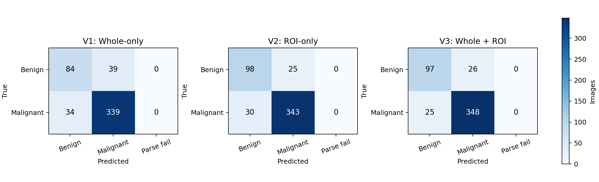
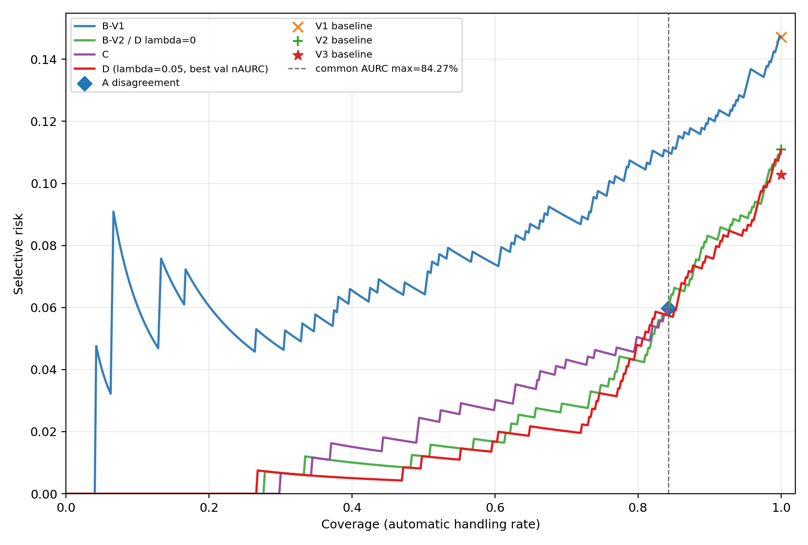

# Thyroid FYP：整图与人工 ROI 的甲状腺超声分类

本项目基于 **TN5000** 与 **Qwen3-VL-4B-Instruct + LoRA**，研究人工标注的结节 ROI 是否能改善甲状腺超声良恶性分类，并探索基于模型置信度的选择性复核（Needs Review）。

当前仓库包含数据审计、V1/V2/V3 训练、验证集评估和 Verify 分析代码，以及不含原始医学图像的聚合结果。**原始 TN5000 数据、逐例预测、模型权重和缓存均不进入 Git。**

## 研究问题

- **V1 — Whole-only：** 仅输入整张超声图像。
- **V2 — ROI-only：** 训练和推理均仅输入人工标注框裁剪的 ROI。
- **V3 — Whole + ROI：** 按固定顺序同时输入整图和对应 ROI。
- **Verify：** 不重新训练模型，根据 V1/V2 的预测和置信度决定是否进入人工复核。

## 核心结果

所有数字均来自同一固定、去重且结构有效的 validation 集：496 张图像，其中良性 123、恶性 373。三组模型使用相同训练划分、随机种子 `20260923` 和 LoRA 参数；V2/V3 均从原始基座独立微调 5 epoch，并按 validation Macro-F1 选择最佳 checkpoint。LoRA 设置为 `r=4`、`alpha=8`、`dropout=0`，目标模块为 `q_proj`/`v_proj`；AdamW 学习率 `1e-4`，microbatch 1、梯度累积 2。

| 模型 | 输入 | Accuracy | Macro-F1 | 良性 Recall | 恶性 Recall | 相比 V1 纠正 / 新增错误 |
|---|---|---:|---:|---:|---:|---:|
| V1 | Whole-only | 85.28% | 0.800 | 68.29% | 90.88% | — |
| V2 | ROI-only | 88.91% | 0.853 | 79.67% | 91.96% | 48 / 30 |
| V3 | Whole + ROI | **89.72%** | **0.862** | 78.86% | **93.30%** | 42 / 20 |



在当前 validation 上，针对 ROI 训练后，V2 和 V3 均超过 V1；V3 表现最高。但这些结果只有一个随机种子，且 checkpoint 也由同一 validation 选择，因此不能视为独立泛化证明，也不能单凭 V3 更高就断言模型确实学会了两种视图的互补信息。

### Verify 探索

V1/V2 逐例关系为：都正确 393 例、仅 V1 正确 30 例、仅 V2 正确 48 例、都错误 25 例；两模型预测不一致 78 例。

在共同可比较的 Coverage 区间 `0–418/496`（84.27%）内：

| 策略 | 共同归一化 AURC ↓ | 说明 |
|---|---:|---|
| B-V1 | 0.06819 | 按 V1 置信度复核 |
| B-V2 | 0.01397 | 按 V2 置信度复核 |
| C | 0.01863 | 分歧或最低置信度不足时复核 |
| D，λ=0.05 | **0.01200** | `V2 confidence − λ × disagreement` |



D 在平均排序指标上优于 B-V2，但在约 60% / 70% / 80% Coverage 时，风险相对 B-V2 分别为持平 / 更低 / 更高，并没有稳定支配 B-V2。当前证据不足以支持仅为 D 增加完整 V1 推理成本。真实标签只用于离线评价，从未作为单样本复核决策输入。

完整聚合结果见 [`results.json`](results.json)。

## 数据与划分

官方 TN5000 包含 5,000 张 JPEG/XML。项目审计发现 119 个精确重复组，其中 65 组跨官方 train/val/test。实验通过文件或解码像素 SHA256 连通组隔离重复样本，优先级为 `test > val > train`。

最终开发数据：

- train：3,384 张（良性 999、恶性 2,385）
- validation：496 张（良性 123、恶性 373）
- test：未用于训练、调参、模型选择或推理；仅在数据审计阶段读取元数据/哈希，并冻结结构异常排除规则

已记录但未原地修复的异常样本：`002589`、`003813`、`004092`。ROI 使用官方加载器规则：XML 四个坐标均减 1，再作为 Pillow 半开区间裁剪；不 padding、不夹紧、不修改原始文件。

数据不随仓库分发。请自行取得 TN5000，并放置为：

```text
data/official/TN5000_forReview/
├── Annotations/<image_id>.xml
├── JPEGImages/<image_id>.jpg
└── ImageSets/Main/{train,val,test,trainval}.txt
```

使用数据前请确认并遵守 TN5000 的官方许可和使用条件。

## 环境

实际运行环境：Python 3.12.3、PyTorch 2.8.0+cu128、CUDA 12.8、RTX 4090 D。

数据审计的最小依赖：

```bash
python -m venv .venv
source .venv/bin/activate
python -m pip install -r requirements.txt
```

训练和 Verify 依赖：

```bash
# 先按本机 CUDA 安装合适的 PyTorch；原实验使用 torch 2.8.0+cu128
python -m pip install -r requirements-train.txt
```

## 主要流程

### 1. 数据审计

```bash
python scripts/check_environment.py
python scripts/check_tn5000.py \
  --data-root data/official/TN5000_forReview \
  --output outputs/phase1_audit \
  --seed 20260923 \
  --preview-count 20
```

### 2. V2/V3 专项训练

训练脚本要求本地已有 Qwen3-VL 基座缓存，默认位置为 `outputs/model_cache/`。

```bash
python scripts/phase3_train_roi.py \
  --mode v2 \
  --run-name phase3_v2_roi_only_seed20260923

python scripts/phase3_train_roi.py \
  --mode v3 \
  --run-name phase3_v3_whole_roi_seed20260923_run2

python scripts/summarize_phase3_roi.py \
  --v2-run outputs/phase3_v2_roi_only_seed20260923 \
  --v3-run outputs/phase3_v3_whole_roi_seed20260923_run2
```

### 3. Verify 分析

第一轮需要 V1/V2 已训练 checkpoint 和保存的 validation 结果；第二轮只读取第一轮 CSV，不加载模型或图像。

```bash
python scripts/phase4_verify.py --run-name phase4_verify_val496
python scripts/phase4_verify_round2.py --run-name phase4_verify_round2_val496
python scripts/generate_verify_report_docx.py
```

所有运行产物写入被 Git 忽略的 `outputs/`。脚本中的固定路径与原实验目录保持一致，迁移环境时应先恢复数据、基座模型缓存和相应 LoRA checkpoint。

## 仓库结构

```text
.
├── README.md
├── results.json                  # 不含逐例信息的机器可读聚合结果
├── requirements.txt             # 数据审计最小依赖
├── requirements-train.txt       # 训练、评估和绘图依赖（PyTorch 单独安装）
├── evidence/                    # 官方数据和源码版本元数据
├── docs/figures/                # 可公开的聚合结果图
├── scripts/
│   ├── check_tn5000.py          # 数据完整性、重复和结构审计
│   ├── phase2_train_full.py     # V1 全量训练
│   ├── phase3_train_roi.py      # V2/V3 训练
│   ├── summarize_phase3_roi.py  # 三模型比较
│   ├── phase4_verify.py         # Verify 第一轮与候选评分
│   ├── phase4_verify_round2.py  # AURC、策略 D 和错误分析
│   └── generate_verify_report_docx.py
└── outputs/                     # 本地忽略：权重、缓存和逐例运行结果
```

## 不进入 Git 的内容

`.gitignore` 明确排除：

- TN5000 原始图像、XML、下载压缩包和数据派生预览
- Qwen3-VL 基座模型、LoRA 权重、checkpoint 和模型缓存
- 逐例预测、sample-level CSV/JSON、训练日志及其他 `outputs/` 产物
- 本机环境、认证信息、密钥与临时文件

因此，克隆仓库可以获得核心代码、配置说明和聚合结果，但不能直接恢复模型权重或原始医学数据。

## 限制

- 所有已报告模型比较和 Verify 参数探索均基于同一个 validation 集。
- 只有一个随机种子，没有患者或结节 ID，无法确认患者级独立性。
- V1/V2 的两候选置信度未经跨模型校准。
- 尚未进行 test 推理或指标评价；最终规则必须在首次 test 评价前冻结。
- 本项目是研究性实验，不构成临床诊断系统或医疗建议。
